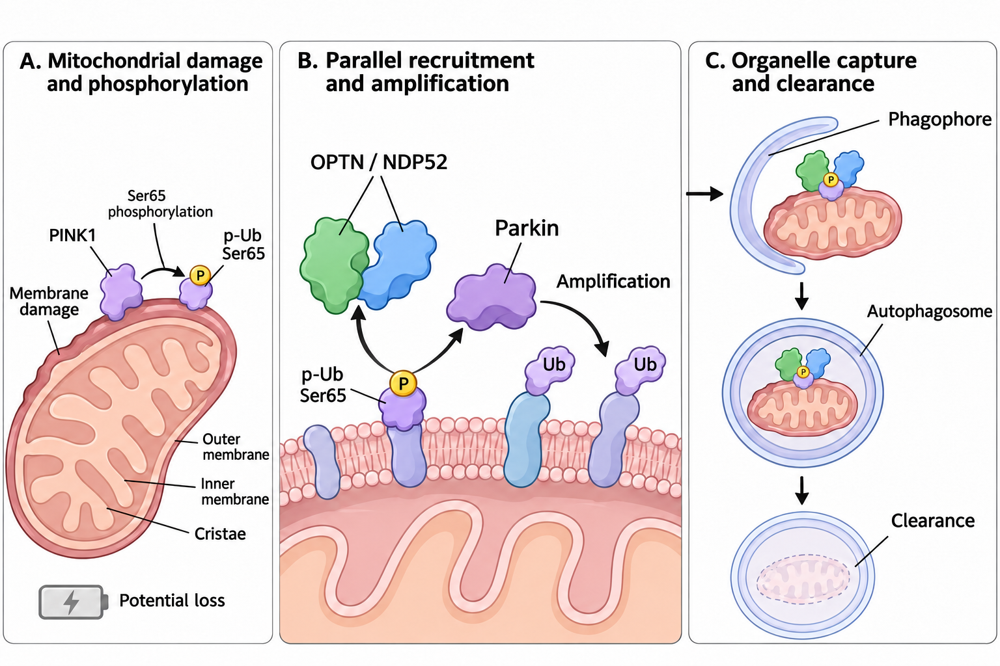
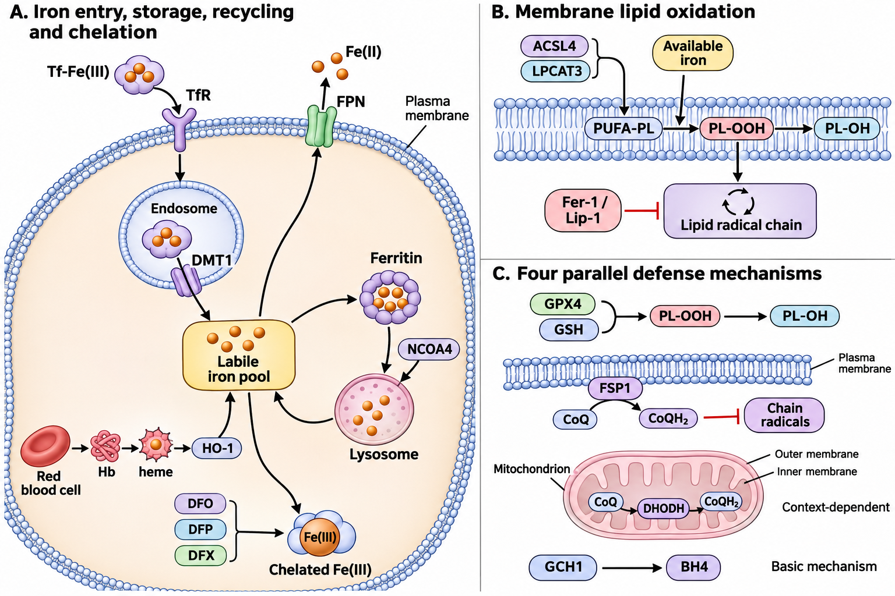
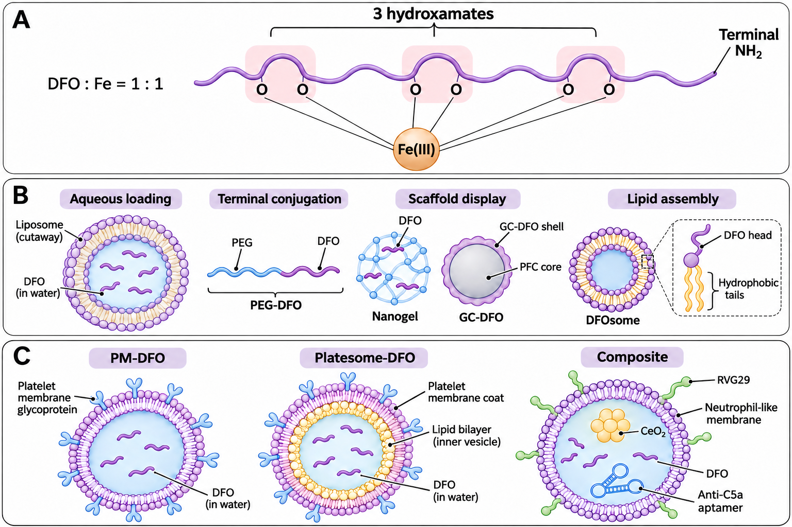

# Bio Mechanism Figures

**生物分子与细胞机制绘图 · Biomolecular and cellular mechanism illustrations**

[简体中文](#简体中文) · [English](#english)

## 示例图 · Examples

三张概念示意图，依次展示细胞机制、铁稳态与脂质防御、分子递送设计。面板标记沿用各图原有版本。

Three concept illustrations showcasing cellular mechanisms, iron homeostasis and lipid defenses, and molecular delivery design, in that order. Each example retains its original panel markers.

### 线粒体自噬机制 · Mitophagy



细胞器膜结构、分子招募和自噬捕获过程。 / Mitochondrial membranes, molecular recruitment and autophagic capture.

### 铁稳态与脂质防御 · Iron homeostasis and lipid defenses



铁的摄取、储存与回收，以及膜脂氧化和并行防御通路。 / Iron uptake, storage and recycling, membrane lipid oxidation and parallel defense pathways.

### DFO 配位与纳米递送 · DFO coordination and nanodelivery



配位示意、载荷位置与不同载体结构。 / Coordination schematic, cargo locations and carrier architectures.

## 简体中文

`bio-mechanism-figures` 是一个供支持 Agent Skills 的智能体使用的绘图技能。它将科学依据、图形设计、实际生图、视觉核对、局部返修和图源记录组织为可复用流程，适用于分子相互作用、信号通路、细胞器、纳米递送及多面板生物医学机制图。

它需要宿主提供实际图像生成或编辑工具；仓库中的 Python 脚本负责整理提示词和记录、校验图源，不直接调用图像模型。

### 默认绘图规则

- 白色背景，简洁的二维生物插图，采用克制的柔和结构色，突出分子与细胞机制。
- 简短英文标签，默认黑色；白字仅用于需要的黑色步骤标记。
- **同一大图内的小图，按阅读顺序使用纯大写英文字母 A、B、C…，不加括号、标点、前缀、圆圈或底框。**
- 核对区室、膜侧、箭头端点、抑制关系、结合方向、配位数与证据范围。
- 用户明确指定的语言、配色、标记方式、版式及确认节点优先。

### 使用方法

将仓库目录放入宿主的 skills 目录，目录名保持为 `bio-mechanism-figures`。例如，Codex 默认使用 `~/.codex/skills/`；如已设置自定义技能目录，请使用该目录。

```text
skills/
└── bio-mechanism-figures/
    ├── SKILL.md
    ├── agents/
    ├── references/
    └── scripts/
```

调用示例：

```text
$bio-mechanism-figures
根据提供的文献与机制描述绘图。
用途：论文机制示意图。
风格：白底、简洁 BioRender 风格、英文黑色标签。
重点：细胞区室、分子作用方向及载荷释放过程。
先生成两张样图给我确认，再继续其余图片。
```

建议一并提供：主要信息、来源或文献标识、确切标签、关键分子及区室、关系方向、输出尺寸，以及需要保留的确认节点。技能会先利用已有信息，再处理影响作图的缺口。

### 工作流程

1. 提取科学约束与来源，区分已支持关系、假说及未知内容。
2. 设计稀疏而清楚的布局，将主要机制落实到可辨认的生物结构。
3. 实际生成图像，检查全图并放大核对高风险区域。
4. 根据可见问题局部返修，检查相邻区域是否出现回归。
5. 遵守样图或整套图片的确认节点，保存版本、请求、提示词、来源和哈希。

可编辑图源为按需启用的分支：文字、箭头、方框及简单形状优先使用原生对象；复杂生物插图可保留为独立、可移动的位图组件。该分支要求真实渲染并与原图对照，不将整张 PNG 包装成“完全可编辑”的图源。

### Python 辅助工具

需要 Python 3.10 或更高版本；当前脚本已在 Python 3.12 下测试。图像记录和校验需要 Pillow。

```bash
python -m pip install -r requirements.txt
python scripts/prepare_brief.py --help
python scripts/record_asset.py --help
python scripts/validate_job.py --help
```

| 工具 | 用途 |
|---|---|
| `prepare_brief.py` | 校验结构化机制描述并编译生图提示词 |
| `record_asset.py` | 将指定的真实工具输出及相关材料保存为独立版本 |
| `validate_job.py` | 核验文件、哈希、版本及与当前图像绑定的复核记录 |

校验器检查记录与字节完整性，不能自行证明图中生物学关系正确。缺少视觉复核的图像保留为 `needs_visual_review`。

### 测试

```bash
python -m unittest discover -s scripts -p test_scripts.py -v
```

现有 21 项脚本测试覆盖标签与区室保留、样式覆盖、无效关系拒绝、版本保护、路径边界、原始请求保存、哈希绑定及未复核状态等行为。`evals/evals.json` 包含七类机制图测试任务，供具备实际绘图工具的宿主继续评测。

前期图像评估实际生成了 19 个版本，包含七个主题、三个首轮对照及局部返修和新机制测试。结果用于改进规则，不表示每次首次生成都会优于普通提示词。后增的纯大写小图标记规则已做提示词与脚本检查，没有为该项更新重新生成全部图片。本仓库展示三张选定示例；私人评审工作区和论文材料未包含在内。

### 文件导航

- [SKILL.md](SKILL.md)：技能入口与主要规则。
- [机制核对](references/mechanism-checks.md)：区室、作用方向、表达过程和证据边界。
- [可编辑交付](references/editable-delivery.md)：原生对象重建、真实渲染及位图组件说明。
- [评估方法](references/evaluation.md)：实际图像对比、评分与修复预算。
- [测试任务](evals/evals.json)：七类机制图测试。

## English

`bio-mechanism-figures` is an Agent Skill for biomolecular and cellular mechanism illustrations. It connects scientific constraints, visual design, actual image generation, inspection, targeted repairs and source tracking. Its scope includes molecular interactions, signaling pathways, organelles, nanodelivery and multi-panel biomedical schematics.

The host must provide an image-generation or editing tool. The Python helpers in this repository prepare prompts and record or validate assets; they do not invoke an image model themselves.

### Default visual conventions

- White background, restrained soft structural colors and clear two-dimensional biological forms.
- Concise English labels in black; white text is reserved for black step markers when needed.
- **Label subpanels within one composite figure with plain uppercase English letters A, B, C, ... in reading order, without punctuation, parentheses, prefixes, circles, boxes or badge backgrounds.**
- Inspect compartments, membrane sides, arrow endpoints, inhibition and binding direction, coordination counts and evidence boundaries.
- Explicit user choices for language, colors, panel markers, layout and approval checkpoints take priority.

### Installation and use

Place the repository in the host's skills directory, keeping the folder name `bio-mechanism-figures`. For example, Codex uses `~/.codex/skills/` by default; use your configured directory if it differs.

```text
skills/
└── bio-mechanism-figures/
    ├── SKILL.md
    ├── agents/
    ├── references/
    └── scripts/
```

Example request:

```text
$bio-mechanism-figures
Create mechanism illustrations from the supplied papers and descriptions.
Purpose: manuscript mechanism schematics.
Style: white background, simple BioRender-inspired forms, black English labels.
Emphasize cellular compartments, molecular directionality and cargo release.
Generate two sample figures for my approval before proceeding with the rest.
```

Useful inputs include the main message, sources or literature identifiers, exact labels, important entities and compartments, relation directions, output dimensions and approval checkpoints. The skill uses available information before asking for missing details that affect the figure.

### Workflow

1. Extract scientific constraints and sources, distinguishing supported relations, hypotheses and unknowns.
2. Design a sparse visual argument using recognizable biological structures.
3. Generate the actual image, inspect the whole figure and enlarge high-risk regions.
4. Repair observed defects locally and check neighboring regions for regressions.
5. Respect approval checkpoints and retain versions, requests, prompts, sources and hashes.

Editable delivery is optional. Use native text, arrows, boxes and simple shapes where feasible; complex biological artwork may remain independently movable raster components. Render the native source and compare it with the reference. Wrapping a whole PNG in a presentation does not make its components editable.

### Python helpers

Use Python 3.10 or newer. The current helpers have been tested on Python 3.12. Asset recording and validation require Pillow.

```bash
python -m pip install -r requirements.txt
python scripts/prepare_brief.py --help
python scripts/record_asset.py --help
python scripts/validate_job.py --help
```

| Tool | Purpose |
|---|---|
| `prepare_brief.py` | Validate a structured mechanism brief and compile a generation prompt |
| `record_asset.py` | Preserve an explicitly supplied tool output and related materials as a separate revision |
| `validate_job.py` | Check files, hashes, revisions and review records bound to the current image |

The validator checks recorded assertions and byte integrity; it does not independently establish biological correctness. An image without visual review remains `needs_visual_review`.

### Tests and evaluation

```bash
python -m unittest discover -s scripts -p test_scripts.py -v
```

The 21 helper tests cover label and compartment preservation, style overrides, invalid relation rejection, revision protection, path boundaries, original-request retention, hash binding and unreviewed status. `evals/evals.json` provides seven mechanism-figure tasks for hosts with an actual image-generation tool.

Earlier image evaluation generated 19 versions across seven topics, three initial baselines, targeted repairs and a new-mechanism test. These results informed the rules; they do not establish consistent first-draw superiority over ordinary prompts. The subsequently added uppercase subpanel-label default was checked in prompt compilation and helper tests without regenerating the complete image set. This repository shares three selected examples; private review workspaces and manuscript materials are not included.

### Repository guide

- [SKILL.md](SKILL.md): entry point and core rules.
- [Mechanism checks](references/mechanism-checks.md): compartments, relations, expression and evidence boundaries.
- [Editable delivery](references/editable-delivery.md): native reconstruction, actual rendering and raster-component disclosure.
- [Evaluation](references/evaluation.md): image comparisons, scoring and bounded repair iterations.
- [Evaluation tasks](evals/evals.json): seven mechanism-illustration tasks.
